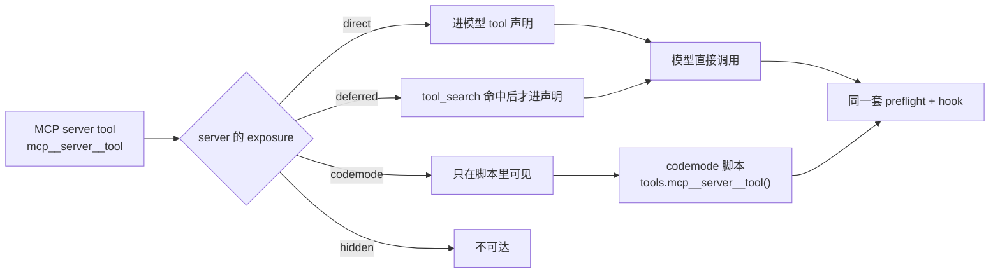

# Agent 的外部能力

> 对应 pi 1.2.0。

## 1. Skills

skill 是一个目录，含 `SKILL.md` 与附属文件。`SKILL.md` 以 frontmatter 开头，后接指令正文。

```
pdf-tools/
├── SKILL.md
├── scripts/
├── references/
└── assets/
```

加载方式是渐进披露：启动时只把每个 skill 的 `name`、`description`、`path` 放进 system prompt，正文在任务匹配时才由模型读 `SKILL.md`。

Agent Skills 规范定义的 frontmatter 字段：

| 字段 | 作用 |
|---|---|
| `name` | 命令名与显示名 |
| `description` | 给模型的路由描述 |
| `license` | 许可证 |
| `compatibility` | 环境要求 |
| `metadata` | 附加键值 |
| `allowed-tools` | 实验性的预批准 tool 列表 |
| `disable-model-invocation` | 从自动选择中隐藏 |

### Pi 的实现

| 项 | 实现 |
|---|---|
| 位置 | `~/.pi/agent/skills/`、`.pi/skills/`，以及 Agent Skills 的 `~/.agents/skills/`、`.agents/skills/` |
| 项目发现 | 项目 `.agents/skills/` 从 cwd 向上发现，遇到 repository root 停止 |
| 启动行为 | 扫描配置的位置，把 name / description / path 加进 system prompt，不加正文 |
| 强制加载 | `/skill:name`；后面的参数作为 user request 追加在指令之后 |
| 只走命令 | frontmatter 设 `disable-model-invocation: true` |
| 命令发现 | `enableSkillCommands` 设置控制 skill 命令是否出现在 interactive 的命令发现里；手输的 `/skill:name` 仍可用 |
| 校验 | malformed `SKILL.md` 与缺 `description` 的 skill 不加载；重名保留先发现的并给 warning |
| 命名限制 | name 用小写字母、数字、连字符，无首尾或连续连字符，最多 64 字符；description 最多 1024 字符 |
| 信任 | `.pi/skills` 受 project trust 保护 |

## 2. MCP

MCP 是 client / server 协议。agent 作 client 连 server，得到两类能力：tools 与 resources。

| transport | 配置方式 |
|---|---|
| stdio | `command`、`args`、`env`、`cwd` |
| streamable HTTP | `url`、`headers`、`oauth` |

legacy SSE transport 不支持。

### Pi 的实现

#### 配置

| 位置 | 说明 |
|---|---|
| `~/.pi/agent/mcp.json` | user 级 |
| `.pi/mcp.json` | project 级，需要 project trust |

格式是 `mcpServers` 映射，与其他 MCP client 一致。

同名条目：project entry 替换 user-level entry。若 project entry 不含 `command`、`url`、`type`，则只覆盖 `enabled`、`exposure`、`toolExposure`，其余字段（`env`、`headers`、`auth`）沿用 user 级。

共有字段：

| 字段 | 说明 |
|---|---|
| `timeout` | 单请求超时秒数，默认 60。progress notification 会重置它 |
| `enabled` | `false` 时保留条目但不连接 |
| `exposure` / `toolExposure` | 决定 tool 如何到达模型 |
| `description` | 一句话说明 server 提供什么 |

#### tool 命名与 exposure

每个 server tool 注册为 `mcp__<server>__<tool>`。codemode 脚本里非法标识符字符变 `_`。

| exposure | 行为 |
|---|---|
| `codemode`（默认） | 可从 codemode 脚本调用；不声明给模型，也不列进 codemode 的 description。脚本用 `searchTools()`、`describeTool()`、`ALL_TOOLS` 找 |
| `deferred` | 不声明，直到 `tool_search` 为下一次模型调用载入匹配 |
| `direct` | 像内置 tool 一样声明给模型，同时可从 codemode 调用 |
| `hidden` | 已注册但不可达 |

`codemode-deferred` 是 `codemode` 的别名。



#### 系统提示

有 `codemode` 或 `deferred` tool 的 server 列在 system prompt 的 `mcp_servers` 段，带到达方式，以及配置的 `description` 一行（连上后用 server instructions 的一行）。

该段在 prompt 开始时更新。内容变化时 Pi 追加新段，而不是改 tool 声明，以保住已有消息的缓存前缀。

#### 连接生命周期

1. session 启动时后台连接所有 enabled server。
2. 首个 prompt 只为带 `direct` tool 的 server 等最多 10 秒，因为它们的声明必须在这次请求里。
3. 其他 server 按需等待：脚本命名了 `mcp__<server>` 就等它；脚本调 `searchTools()` 或读 `ALL_TOOLS` 就等全部；`tool_search` 与 resource tools 也等全部。
4. HTTP 网络错误与 408 / 429 / 5xx 重试两次。
5. 断线显示为 disconnected，下次调用时重连。
6. server 变更 tool 列表时，新增的生效，撤回的变为不可达。

#### resources

| tool | 作用 |
|---|---|
| `list_mcp_resources` | 列 resources，返回 JSON，支持分页 cursor |
| `list_mcp_resource_templates` | 列 URI templates |
| `read_mcp_resource` | 按 server 与 uri 读取 |

文本以文本给模型，图片以图片给模型，其他二进制存进临时文件并把路径给模型。脚本拿到 `{ server, uri, contents }`。

这三个 tool 的 exposure 取相关 server 中最宽的一档：`direct` > `codemode` / `deferred`。`ui://` URI 与 MCP Apps 内容不渲染，直接忽略。

codemode 脚本拿到完整的 `CallToolResult`，含 `content`、`structuredContent`、`isError`。

#### 管理与关闭

- `/mcp`：TUI 内交互式检查、重连、登录、改 exposure、启停。非 TUI 下打印状态。
- `pi mcp add` / `remove` / `list` / `login` / `logout`：shell 命令，不加载 extension。
- 日志写入 `~/.pi/agent/mcp.log`，超过 5 MB 轮转为 `mcp.log.1`。
- 关闭内置支持：`--no-mcp`（单次）、`pi config` 里禁用 built-in `mcp`、或 settings 写 `"extensions": ["-builtin:mcp"]`。
- extension 可注册 server：`pi.registerMcpServer(name, config)` / `pi.unregisterMcpServer(name)`。extension 加载期间注册的随 session 启动一起连，之后注册的立即连。`mcp.json` 里同名条目优先。

## 3. Extensions

extension 是宿主进程内的 module，导出默认工厂函数。工厂拿到一个 API 对象，用它注册能力并订阅事件。

四类可分发资源的分工：extension 加行为，skill 加按需指令，prompt template 加可复用消息文本，theme 加终端配色。

### Pi 的实现

#### 加载

| 项 | 实现 |
|---|---|
| 位置 | `~/.pi/agent/extensions/`、`.pi/extensions/`、packages |
| 单次加载 | `--extension ./hello.ts`，或 `-e npm:@example/pi-tools` |
| 语言 | 用 `jiti` 直接加载 TypeScript，无需预编译 |
| 形态 | 单文件或目录；npm 依赖放附近的 `package.json` |
| 工厂 | 可同步可异步。异步工厂会被等待，所以启动期的 provider 注册能生效 |
| 生命周期约束 | 不在工厂里开进程、socket、watcher、timer；长生命周期资源从 `session_start` 或需要的命令 / tool 里开；`session_shutdown` 幂等关闭 |

#### 注册点

| 方法 | 注册什么 |
|---|---|
| `pi.registerTool()` | tool |
| `pi.registerCommand()` | 斜杠命令 |
| `pi.registerShortcut()` | 快捷键 |
| `pi.registerFlag()` | 命令行 flag |
| `pi.registerProvider()` | model provider |
| `pi.registerVirtualModel()` | virtual model |
| `pi.registerMcpServer()` | MCP server |
| `pi.registerToolRenderer()` | tool 的 TUI renderer |

其他 API：`pi.on()`、`pi.getActiveTools()`、`pi.setActiveTools()`、`pi.getAllTools()`、`pi.getMcpServers()`、`pi.unregisterMcpServer()`、`pi.appendEntry()`、`pi.sendMessage()`、`pi.sendUserMessage()`。

#### 事件

| 阶段 | 事件 |
|---|---|
| session | `session_start`、`session_shutdown`、`project_trust` |
| run 边界 | `before_agent_start`、`agent_end`、`agent_before_settle`、`agent_settled`、`turn_end` |
| 消息 | `message_end`、`custom_message` |
| context | `context_with_system`、`context_edit` |
| tool | `tool_call`、`tool_result`、`tool_execution_start`、`tool_execution_update`、`tool_execution_end`、`tool_search` |
| provider 与其他 | `provider_stream_event`、`cache_warming_decision`、`mcp_servers_change`、`user_bash` |

handler 按 stream 顺序 await，慢 handler 会拖慢 stream 消费。handler 报错只上报，不改 provider 响应。

`agent_before_settle` 是最后一个可动作的边界，能追加 entry 并请求一次继续。`agent_settled` 只做通知。

#### tool exposure

| exposure | 行为 |
|---|---|
| `direct`（默认） | 激活时声明给模型，同时可被其他 tool 调用 |
| `model-only` | 激活时声明给模型，永不可被调用 |
| `codemode` | 注册即可调用，并列进 `codemode` 的 description；不声明给模型 |
| `deferred` | 同 `codemode`，但 codemode 不列出它；`tool_search` 可找到并激活 |
| `hidden` | 已注册但不可达。tool 不能注销，改 exposure 为 `hidden` 即撤回 |

注册 `direct` 或 `model-only` 会立即激活；其他档注册时不激活。active set 是声明给模型的集合。

| 概念 | 说明 |
|---|---|
| `namespace: { name, aliases, description, instructions }` | 分组相关 tool。`description` 列出，`instructions` 不列出、由脚本用 `describeNamespace()` 读。`aliases` 是脚本可用的别名 |
| `annotations` | `readOnlyHint`、`destructiveHint`、`idempotentHint`、`openWorldHint`。缺失时按 MCP 默认：非只读、可能破坏性、可能开放世界。可用于权限确认 |
| `reachesTools(input)` | 声明一次调用可能触及哪些 tool：`"all"`，或输入里可能命名它们的词 |
| `prepareLoadout(loadout)` | 编排型 tool 调整模型看到的工具清单，返回替换后的 `descriptions` 与 `hiddenDeclarations` |

动态激活：先注册全部 tool，保持可选的处于非激活，用 loader tool 调 `pi.setActiveTools()`。未注册的名字被忽略。

transcript 影响：Pi 把初始 prompt 与 tool set 记进第一条 system message，之后追加变更。无法表达该变更的 provider 会收到完整 transcript checkpoint，可能让缓存前缀失效。

#### 信任与分发

需要 project-trust 决定的资源：`.pi/settings.json`、`.pi/mcp.json`、`.pi/extensions`、`.pi/skills`、`.pi/prompts`、`.pi/themes`、`.pi/SYSTEM.md`、`.pi/APPEND_SYSTEM.md`、项目 `.agents/skills`。裸 `.pi` 目录不需要。

非交互模式无法弹信任提示，用 `defaultProjectTrust`（`always` / `ask` / `never`）或 `--approve` / `--no-approve`。

Pi package 把 extensions、skills、prompt templates、themes 作为一个单位分发，来源可以是 npm、git 或本地路径。个人安装写 `~/.pi/agent/settings.json`，`--local` 写 `.pi/settings.json`（后者需 project trust）。
