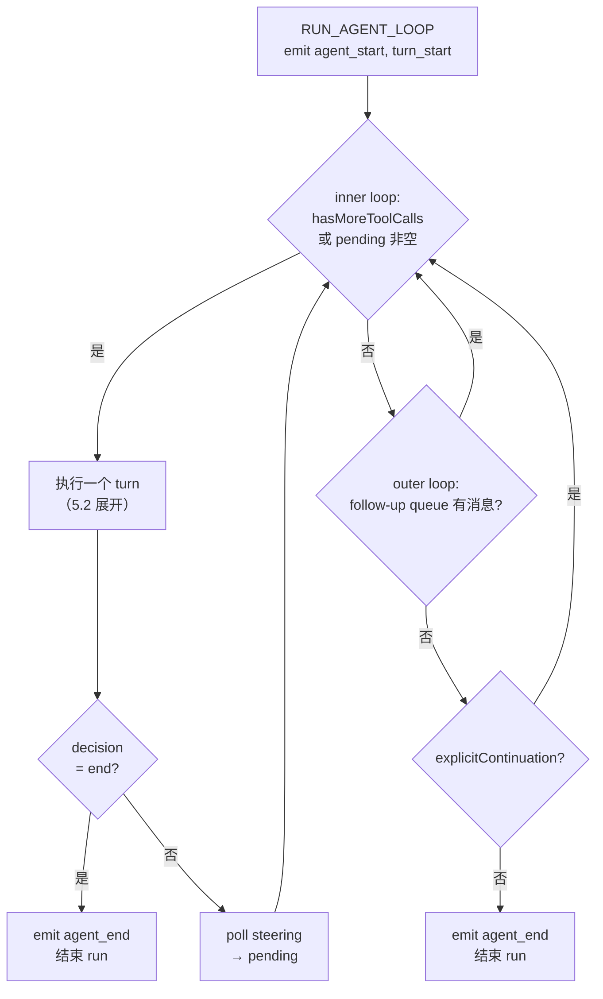
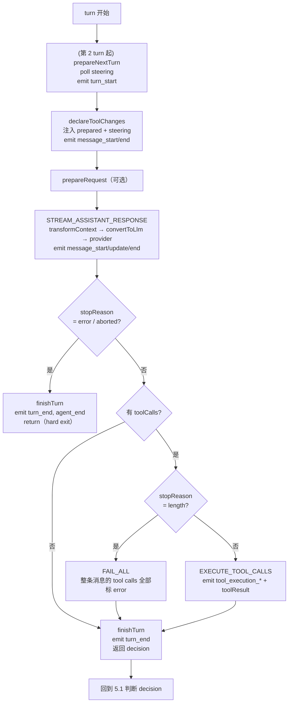
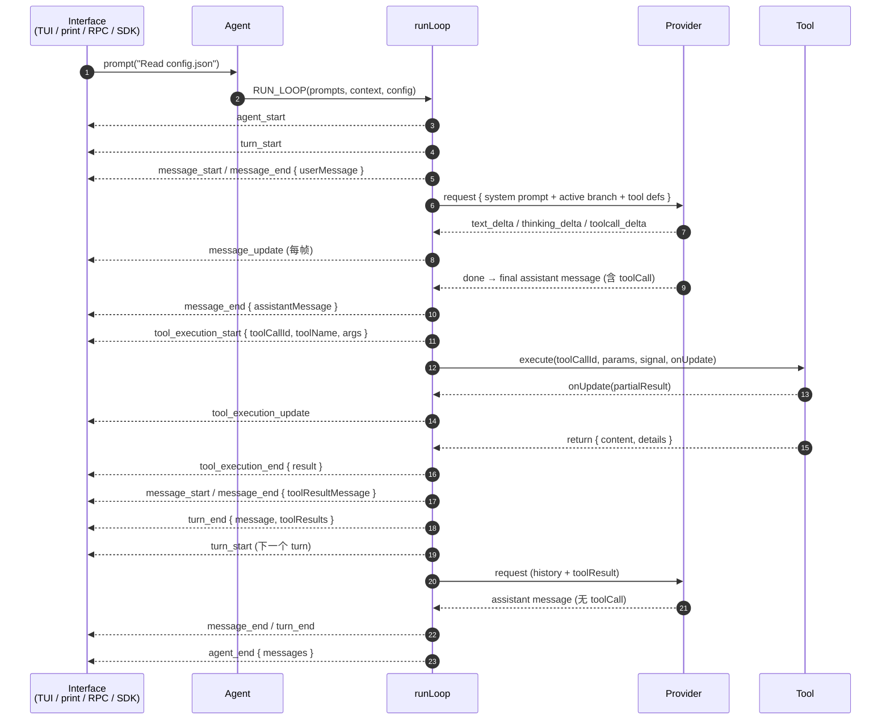
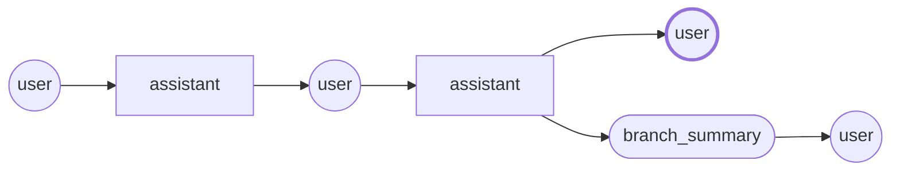
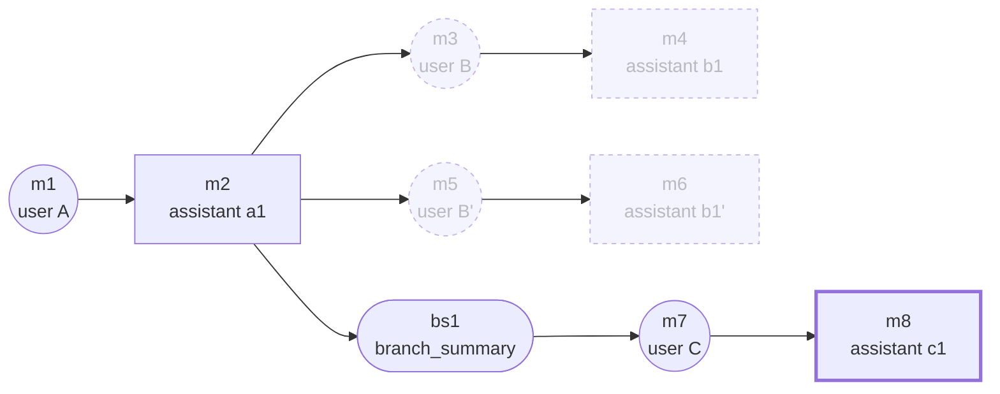

# 以 Pi 为例的 Agent 分析

> 对应 pi 1.2.0（`pi-coding-agent` / `pi-agent-core` / `pi-ai` 均为 1.2.0）。

## 1. 组件

分三层：`pi-coding-agent`（Interface）、`pi-agent-core`（Agent）、`pi-ai`（Model）。

### 核心组件

| 组件 | 负责什么 |
|---|---|
| Interface<br/>`pi-coding-agent` | 收集用户输入，渲染 agent 事件。四种模式：interactive、print、JSON、RPC |
| Session | JSONL 树，存 messages / tool calls / compaction 等 entry。active branch 提供 history |
| Agent | 持 state、queues、订阅者。包住 loop，对外暴露 `prompt()` / `steer()` / `followUp()` / `abort()` |
| **runLoop** | 驱动 turn。决定何时请求模型、执行 tool、何时结束 run。核心逻辑 |
| StreamFn / provider | 发一次请求，流式返回 assistant message。唯一访问网络的组件 |
| Tool | 执行一个 tool call，返回 result。可流式上报 partial result |
| AgentContext | `messages`（当前 branch 历史）+ `tools`（可执行的 tool set） |
| emit | 把 loop 内部状态发成 `AgentEvent` 给 UI |

### 可插拔点

| 组件 | 负责什么 |
|---|---|
| convertToLlm | `AgentMessage[]` → `Message[]`。每个 turn 一次 |
| transformContext | 请求前对 `messages` 裁剪或注入，可选 |
| prepareNextTurn | 每个 turn 开始前重建 context / model，可选 |
| prepareRequest | 每次 provider 请求前重建 context，可选 |
| finishTurn | turn 收尾，返回 `end` / `continue` / 无，决定是否继续 |
| beforeToolCall / afterToolCall | tool 执行前后的 hook，可拦截或改写 result |
| steering queue | 当前 assistant turn 之后插入的消息 |
| follow-up queue | agent 本来要停止时才插入的消息 |

### 数据类型

| 概念 | 说明 |
|---|---|
| `AgentMessage` | 应用层消息：`user` / `assistant` / `toolResult`，可扩展自定义 role |
| `Message` | LLM 消息：模型只认识 `user` / `assistant` / `toolResult` |
| turn | 一次 LLM 请求 + 该请求发出的所有 tool calls |
| run | 一次 `prompt()` / `continue()` 触发的若干 turn |
| `AgentEvent` | `agent_start` … `agent_end` |
| `AgentLoopConfig` | `model`、`convertToLlm`、`toolExecution`、hooks、queues |

`AgentContext.tools` 是 runtime 能执行的集合；transcript 里的 system message 声明模型可调用的集合。

## 2. 最简形态

不含 steering、follow-up、compaction。只看 loop 骨架。

```
RUN_LOOP(context, prompts):
    append prompts to context
    emit agent_start

    loop:
        # 末尾必须是 user 或 toolResult，否则 provider 拒绝
        if context.messages 末尾不是 user / toolResult: break

        emit turn_start
        message = STREAM_ASSISTANT_RESPONSE(context)
        append message to context

        if message.stopReason in {error, aborted}:
            emit turn_end; break

        toolCalls = message 中的 tool call
        if toolCalls 为空:
            emit turn_end; break

        results = EXECUTE_TOOL_CALLS(toolCalls)
        append results to context
        emit turn_end

    emit agent_end
```

```
STREAM_ASSISTANT_RESPONSE(context):
    messages = convertToLlm(context)                # AgentMessage[] → Message[]
    stream = provider(model, messages)

    for each event in stream:
        start:       append partial to context; emit message_start
        *_delta:     原地替换 context 末尾 partial; emit message_update
        done / error: 原地替换为 final; emit message_end; return final
```

```
EXECUTE_TOOL_CALLS(toolCalls):
    results = []
    for each call in toolCalls:
        result = tool.execute(call.args)
        emit tool_execution_start / tool_execution_end
        append result 到 results
    return results
```

循环条件只有一条：上一步产生了 tool result，就再请求一次。

## 3. 与 provider 通信

### 在哪里

`STREAM_ASSISTANT_RESPONSE` 里的 `provider(model, messages)` 一步。这个函数就是 `StreamFn`：

```
StreamFn(model, context: TranscriptContext, options?) → AssistantMessageEventStream
```

agent-core 不认识任何 provider。默认 streamFn 由宿主通过 `setDefaultStreamFn()` 安装。

### 通信方式

每个 provider 用官方 SDK 走 HTTPS，统一开启流式：

| api | SDK |
|---|---|
| `anthropic-messages` | `@anthropic-ai/sdk` |
| `openai-completions` / `openai-responses` / `azure-openai-responses` / `openai-codex-responses` | `openai` |
| `google-generative-ai` / `google-vertex` | `@google/genai` |
| `bedrock-converse-stream` | `@aws-sdk/client-bedrock-runtime` |

响应是 SSE，逐块解析成 `AssistantMessageEvent`：

```
start
text_start / text_delta / text_end
thinking_start / thinking_delta / thinking_end
toolcall_start / toolcall_delta / toolcall_end
done | error
```

失败编码在流里：以 `error` 事件结束，最终 `AssistantMessage` 的 `stopReason` 为 `error`。不抛异常。

### 传进去的格式

同一份对话在四层里有四种形状：

| 层 | 类型 | 谁产出 |
|---|---|---|
| loop / session | `AgentMessage[]` | loop 自己 append |
| 请求前 | `Message[]` | `convertToLlm()` |
| provider 入口 | `TranscriptContext` | `normalizeContext()` |
| wire | provider 原生 JSON | 各 provider 的 `buildParams()` / `convertMessages()` |

`Context.systemPrompt` 与 `Context.tools` 只是 shorthand。`normalizeContext()` 把它们折成一条 leading system message。system prompt 与 tool 声明都由 system message 承载。

`Message` 四种：

| role | 字段 |
|---|---|
| `system` | `content`、`sections?`、`toolsAdded?`、`toolsRemoved?`、`timestamp` |
| `user` | `content: string \| (Text \| Image)[]`、`timestamp` |
| `assistant` | `content: (Text \| Thinking \| ToolCall)[]`、`api`、`provider`、`model`、`usage`、`stopReason`、`timestamp` |
| `toolResult` | `toolCallId`、`toolName`、`content: (Text \| Image)[]`、`details?`、`isError`、`timestamp` |

block 与 wire 的映射（以 `anthropic-messages` 为例）：

| pi 的 block | Anthropic 的 block |
|---|---|
| Text | `{ "type": "text", "text": "..." }` |
| Image | `{ "type": "image", "source": ... }` |
| ToolCall | `{ "type": "tool_use", "id", "name", "input" }` |
| ToolResult | `{ "type": "tool_result", "tool_use_id", "content" }` |
| Tool 声明 | `{ "name", "description", "input_schema" }` |

`stopReason` 的映射：

| wire | pi 的 `StopReason` |
|---|---|
| `end_turn` | `stop` |
| `max_tokens` | `length` |
| `tool_use` | `toolUse` |
| `refusal` | `error` |

### 极简例子

用户输入 `why is sky blue`。

**1. loop 里的 `AgentMessage[]`**

```ts
[
  { role: "system", content: "You are a coding agent.", timestamp: 0 },
  { role: "user",   content: "why is sky blue",          timestamp: 1 },
]
```

**2. Anthropic 请求体**（省去 `cache_control`、`betas` 等字段）

```json
POST https://api.anthropic.com/v1/messages

{
  "model": "claude-sonnet-4-6",
  "max_tokens": "<model.maxTokens>",
  "stream": true,
  "system": [
    { "type": "text", "text": "You are a coding agent." }
  ],
  "tools": [
    {
      "name": "read",
      "description": "Read a file",
      "input_schema": {
        "type": "object",
        "properties": { "path": { "type": "string" } },
        "required": ["path"]
      }
    }
  ],
  "messages": [
    { "role": "user", "content": [{ "type": "text", "text": "why is sky blue" }] }
  ]
}
```

**3. 返回的 SSE 归一化成事件**

```
start                → partial AssistantMessage
 text_delta "Rayleigh scattering"
 text_end
done                 → AssistantMessage {
                         content: [{ type: "text", text: "..." }],
                         stopReason: "stop",
                         usage: { input, output, cacheRead, cacheWrite, totalTokens, cost },
                         api, provider, model, timestamp
                       }
```

**4. loop 收尾**

`stopReason: "stop"` 且没有 `toolCall` block → `emit turn_end` → break → `emit agent_end`。

### 带 tool call 时多出什么

model 不发 `text` 而发 `tool_use`：assistant message 的 `content` 里多一个 `ToolCall` block。loop 用它执行 tool，结果作为下一条 `user` 消息里的 `tool_result` 发回。

```json
{
  "role": "assistant",
  "content": [
    { "type": "text", "text": "Let me look." },
    { "type": "tool_use", "id": "toolu_01", "name": "read", "input": { "path": "a.txt" } }
  ]
}

{
  "role": "user",
  "content": [
    { "type": "tool_result", "tool_use_id": "toolu_01",
      "content": [{ "type": "text", "text": "..." }] }
  ]
}
```

loop 侧看到的是 pi 内部名 `toolCall`（wire 上是 `tool_use`），`stopReason` 为 `toolUse`。

## 4. 扩展点

每个特性都不改 loop 骨架，只挂在某个阶段上。

| 特性 | 插入点 | 增加什么 |
|---|---|---|
| 权威 context / compaction | turn 开始前 | `prepareNextTurn`：返回新的 context、model、附带消息 |
| context 重建 | 每次请求前 | `prepareRequest`：返回新的 context |
| 工具集变更声明 | 请求前、注入消息时 | `declareToolChanges`：diff runtime tools 与 transcript 声明，合成 system message |
| 权限拦截 / 结果改写 | tool 执行前后 | `beforeToolCall` / `afterToolCall`；`beforeToolCall` 可返回 `block` |
| 提前停止 | turn 收尾 | tool result 带 `terminate: true`；整批都是才停 |
| 强制结束 / 强制继续 | `turn_end` 之前 | `finishTurn` 返回 `{action: "end"}` / `{action: "continue"}` |
| tool 并发 | `EXECUTE_TOOL_CALLS` | parallel 模式：顺序 preflight，并发 execute |
| 截断保护 | toolCalls 非空分支开头 | `stopReason == length` 时整条消息的 tool calls 全部标 error，不执行 |
| UI-only 消息 / 自定义 role | 请求前 | `transformContext` + `convertToLlm` |
| 过期 token | 每次请求前 | `getApiKey(provider)` 重新解析 |

### 改了控制流的三个

只有这三个动循环条件：

| 特性 | 插入点 | 效果 |
|---|---|---|
| compaction | 每个 turn 开始前 | `prepareNextTurn` 可能跑很久（例如生成 summary），期间要再 poll 一次 steering |
| steering | 每个 turn 结束后 | 队列非空则继续循环，消息在下一 turn 请求前注入 |
| follow-up | loop 本来要 `break` 时 | 队列非空则回到循环顶，外层再包一层 loop |

展开后有内外两层：

```
loop forever:                                   # outer：follow-up
    loop while 有新输入:                          # inner：一个 turn
        # turn 开始前
        snap = prepareNextTurn(上一个 turn)       # compaction，可能很慢
        if snap: context, model = snap
        if pending 为空: pending = steering queue # 慢操作后补 poll
        emit turn_start
        declareToolChanges(prepared + pending)

        # 请求前
        upd = prepareRequest(context)
        if upd: context, model = upd

        # 请求 + 执行
        message = STREAM_ASSISTANT_RESPONSE(context)
        if message.stopReason in {error, aborted}: hard exit
        toolCalls 非空 → EXECUTE_TOOL_CALLS

        # turn 收尾
        decision = finishTurn(这个 turn)
        emit turn_end
        if decision == end: 结束 run
        pending = steering queue
        if 有 toolCalls 或 pending 非空: 忽略 continue

    pending = follow-up queue
    if pending 非空: continue
    if 需要补一次 context-only turn: continue
    break
```

### 行为规则

- 第一个 `turn_start` 由入口发出；loop 内只在有上一个 turn 时发出。
- streaming 期间 context 末尾是当前部分消息，完成后原地替换为 final。
- one-at-a-time 模式下，若已拿到 steering 就不再 poll，避免一个 turn 塞两条。
- `error` / `aborted` 是 hard exit：不执行 tool、不 poll queue、`finishTurn` 的 decision 被忽略。
- `runToolCall()` 把同一套 preflight 步骤导出给 codemode，model 写的 JS 调 tool 也经过两个 hook。

## 5. 控制流

### 5.1 循环骨架



outer loop 与 inner loop 是同一个节点的两条入口：follow-up 与 `explicitContinuation` 都只是回到 inner loop 再跑一轮。

### 5.2 turn 展开



## 6. 事件时序（带 tool call 的一次 run）



## 7. session 与 tree

### 存储

session 是一个 JSONL 文件。第一行是 header，不进树：

```json
{"type":"session","version":3,"id":"uuid","timestamp":"...","cwd":"/path/to/project"}
```

之后每行一个 entry，共同字段：

```ts
interface SessionEntryBase {
  type: string;
  id: string;              // 8 位 hex，回退为完整 UUID
  parentId: string | null; // null = root
  timestamp: string;       // ISO 8601
}
```

entry 类型：`message`（内含 `AgentMessage`）、`model_change`、`thinking_level_change`、`usage`、`compaction`、`branch_summary`、`context_edit`、`custom`、`custom_message`、`label`、`session_info`。

### 树

entry 通过 `parentId` 组成树。`leafId` 是当前位置，从 leaf 走到 root 得到 active branch。



圆形 = user / `custom_message`，矩形 = 其他 entry，两端圆角 = `branch_summary`，粗边 = leaf。

可以有多棵树：`resetLeaf()` 之后 append 的 entry，`parentId` 为 null，成为新的 root。

### 三个命令

| 命令 | 实现 | 结果 |
|---|---|---|
| `/tree` | 移动同一文件内的 `leafId` | 相关方案留在同一文件 |
| `/fork` | `createBranchedSession(targetLeafId)` | 从更早的 user message 起，开新文件 |
| `/clone` | `fork(leafId, { position: "at" })` | 复制当前 active branch 到新文件 |

`/tree` 选中一条 entry 时，新 leaf 的位置：

- 选中 user message 或 `custom_message`：leaf = 该 entry 的 `parentId`，原文放回编辑器
- 选中其他 entry（assistant、toolResult 等）：leaf = 该 entry 本身，编辑器留空

`createBranchedSession(leafId)` 只把 root → leaf 这一条路径写进新文件。`label` entry 重挂到路径上，`compaction` 的 `parentId` 与 `firstKeptEntryId` 重映射。新 header 的 `parentSession` 指向原文件。

另一条路径：`SessionManager.forkFrom()` 用于跨 project 的 `--fork <path|id>`，把原文件的全部 entry 原样复制（id / parentId 不变），只换 header 的 `id`、`cwd`、`parentSession`。

### 跳到某个位置时 summarize 与否

两种情况都是移动 leaf。区别在于是否在**进入的那条分支上**追加一条 entry。

| | 写入 | 新分支的模型 context |
|---|---|---|
| summarize | `branch_summary` entry，`parentId` = 新 leaf，`fromId` = 离开时的 leaf | 多一条 `branchSummary` 消息，描述被放弃那条路做过什么 |
| 不 summarize | 无新 entry，只改 leaf 指针 | 只有新 leaf 的祖先，被放弃那条路的内容完全不出现 |

summary 挂在**新位置**（`branchWithSummary(newLeafId, ...)`），不挂在被放弃的分支上。无 summary 且目标为 root 时走 `resetLeaf()`，否则走 `branch(newLeafId)`。

`branch_summary` 的内容由 `collectEntriesForBranchSummary()` 收集：找 old leaf 与 new leaf 的最近公共祖先，从 old leaf 往回走到该祖先，按 token 预算取消息（新的优先），再让 LLM 生成结构化 summary（Goal / Constraints & Preferences / Progress / Key Decisions / Next Steps）。

对比 compaction：同格式，但 compaction 作用在当前分支内部（`/compact` 或超过 `contextWindow - reserveTokens` 时自动），`branch_summary` 作用在跨分支导航时。

### LLM 看到什么

从 leaf 走到 root，再应用最新 compaction 与 `context_edit`：

| entry | 变成 |
|---|---|
| `message` | 存的 `AgentMessage` |
| `compaction` | 一条完整 system checkpoint + 一条 `compactionSummary` |
| `branch_summary` | `branchSummary` |
| `custom_message` | `CustomMessage` |
| `context_edit` | 自身不产生消息，只替换目标 entry 的内容 |
| `usage`、`custom` | 不产生消息 |

compaction entry 带 `firstKeptEntryId`，只从该 entry 起发给模型，之前的用 summary 代替。原始 entry 全部留在文件里。

### 不进 TUI 的用法

| 需求 | CLI（`--print`） | RPC | SDK |
|---|---|---|---|
| 不进 TUI | 可以 | 可以 | 可以 |
| 选树上的具体位置 | 不可以，只有整会话的 `--fork <path\|id>` | 只能 `fork`（给 user message 的 entryId）或 `clone`（当前 branch），都开新文件 | `branch(id)` / `resetLeaf()` / `branchWithSummary()` |
| 自定义 summarize 提示词 | 不可以 | 只有 `compact {customInstructions}`，作用在当前 branch | `generateBranchSummary(entries, { customInstructions, replaceInstructions })` |
| 直接跑新 prompt | `-p "..."` | `prompt` | `prompt()` |

SDK 从包根导出 `SessionManager`、`collectEntriesForBranchSummary`、`prepareBranchEntries`、`generateBranchSummary`。

```
1. sm = SessionManager.open(path)              # 或 continueRecent(cwd)
2. oldLeafId = sm.getLeafId()
   targetId  = 从 sm.getTree() 里选一个 entry
3. newLeafId = 目标是 user message 或 custom_message
                ? entry.parentId
                : entry.id                      # 目标是 root 时为 null
4. collected = collectEntriesForBranchSummary(sm, oldLeafId, targetId)
5. result = generateBranchSummary(collected.entries, {
       model, apiKey, signal,
       customInstructions, replaceInstructions,
   })
6. sm.branchWithSummary(newLeafId, result.summary, { readFiles, modifiedFiles })
   # 不 summarize：sm.branch(newLeafId)
   # 目标是 root：sm.resetLeaf()
7. { session } = await createAgentSession({ cwd, sessionManager: sm })
   session.prompt(...)
```

两个内部行为：

- `customInstructions` 默认**追加**，拼成 `Additional focus: <文本>`。`replaceInstructions: true` 才替换默认的 `BRANCH_SUMMARY_PROMPT`。
- 自己生成的 summary 不要设 `fromHook: true`。pi 只累加 Pi 自己生成的 summary 的文件列表。

两个缺口：

- CLI 的 `--fork` 走 `SessionManager.forkFrom()`，把原文件全部 entry 原样复制（id 不变），只换 header 的 `id`、`cwd`、`parentSession`。不能选位置，不带 summarize 提示词。
- RPC 的 `get_tree` / `get_entries` 只读，没有「移动 leaf + 自定义 summary」的命令。最接近的组合是 `get_tree` → `fork` → `compact {customInstructions}`，但 compaction 的 summary 覆盖当前 branch 里被保留的那段，不是被放弃的那段。

### 多次操作后的存储

初始 `s1.jsonl`。`←` 表示 `parentId`。

```
header   id=S1

m1  user        "A"      root
m2  assistant   "a1"     ← m1
m3  user        "B"      ← m2
m4  assistant   "b1"     ← m3      (leaf)
```

**1. `/tree` 选 m3（user "B"），改成 "B'" 提交**

leaf 移到 `m3.parentId` = m2，"B" 回到编辑器。提交后开新分支，再跑一轮：

```
m5  user        "B'"     ← m2
m6  assistant   "b1'"    ← m5      (leaf)
```

m3、m4 不动。文件仍是 `s1.jsonl`。

**2. `/tree` 选 m3 并 summarize**

leaf 移到 m2，同时在**新位置**追加 summary entry（`fromId` 是离开时的 leaf `m6`）：

```
bs1 branch_summary  "S: A/B 已确认…"   ← m2, fromId=m6
m7  user            "C"               ← bs1
m8  assistant       "c1"              ← m7      (leaf)
```

树：



虚线 = 被放弃的分支，粗边 = leaf。

active branch = m1 → m2 → bs1 → m7 → m8。

**3. `/clone` → `s2.jsonl`**

`fork(leafId=m8, { position: "at" })` → `createBranchedSession(m8)`。只写 root→m8 这一条路径：

```
header   id=S2, parentSession=s1.jsonl

m1, m2, bs1, m7, m8          # id 不变
```

`s1.jsonl` 不变。

**4. `/fork` 选 m3 → `s3.jsonl`**

目标若是 user message，`position` 为 `before`，leaf = `m3.parentId` = m2：

```
header   id=S3, parentSession=s1.jsonl

m1, m2                       # id 不变
```

编辑器里是 "B"。提交后新 entry 挂在 m2 下面。

**5. 在 `s2.jsonl` 上 `/compact`**

```
cx1 compaction  "S2: 目标…"   ← m8, firstKeptEntryId=m7
```

模型收到的是：

```
system checkpoint
compactionSummary   "S2: 目标…"
user                "C"          # m7 起原样发送
assistant           "c1"
```

m1、m2、bs1 不再发送给模型，但都留在文件里。

loop 只看到 `prepareRequest` 返回的 context。

## 8. TUI

`@earendil-works/pi-tui`，interactive mode 的渲染层。

component 模型：一个 component 为给定宽度渲染一组终端行，可选处理键盘与鼠标输入，状态或主题变化时自己 invalidate 缓存。

内置 component：

| 类别 | 组件 |
|---|---|
| 内容 | `Text`、`Markdown`、`Image`、`TruncatedText` |
| 布局 | `Container`、`VStack`、`HStack`、`Box`、`Spacer` |
| 输入 | `Input`、`Editor`（替换主编辑器用 `CustomEditor`） |
| 选择 | `SelectList`、`SettingsList` |
| 其他 | `ScrollView`、`Loader`、`CancellableLoader`、`MouseRegion` |

宽度与样式：

- 用 `visibleWidth()` / `truncateToWidth()` / `sliceByColumn()` / `wrapTextWithAnsi()` 处理列宽，不要自己实现。
- 每行必须落在给定宽度内。
- Pi 每行结束后重置样式与超链接，所以每行要重新应用样式。

渲染：状态变化后 invalidate 受影响的 component，再调 `tui.requestRender()`。TUI 会合并渲染请求。

focus 与光标：

- 显示文本光标的 component 实现 `Focusable`，把 `CURSOR_MARKER` 放在可视光标前。
- 光标单元用 `renderFakeCursor()` 包裹，显示硬件光标时它被隐藏。
- 包裹 `Input` 或 `Editor` 的容器必须把 `focused` 传给子组件，否则 IME 候选窗会出现在错误位置。

自定义界面：`ctx.ui.custom()` 让一个 component 临时接管 interactive 区域，resolve 于组件调用完成回调时。传 `overlay: true` 叠加绘制，overlay handle 可控 focus、`setHidden()`。这类 overlay 不要调 `OverlayHandle.hide()`。

键盘：`matchesKey()` 与 `Key`。extension component 用注入的 `KeybindingsManager`。

调试：`PI_TUI_WRITE_LOG` 抓原始 ANSI 流。

## 9. Codemode

一个 tool，输入是**原始 JavaScript 源码**，不是 JSON，也不是 markdown code fence。脚本在 QuickJS sandbox 里作为 async function body 执行，所以顶层 `await` 与 `return` 可用。sandbox 无 Node API、文件系统、网络、timer。

开启方式：`defaultTools: ["+codemode"]` 或 `--tools +codemode`。

### 脚本

首行可以是 options 行，必须在首行：

```js
// @options: {"max_output_tokens": 2000, "timeout_ms": 60000}
```

globals：

| global | 作用 |
|---|---|
| `tools.<name>(args)` | 调用一个 tool |
| `text(value)` | 追加一个 text item |
| `image(value)` | 追加一张图片，并保存到 temp file |
| `console.log(...)` | 追加一行到 `<console_output>` 块 |
| `return value` | 顶层 return，等同 `text()` |
| `exit()` | 成功结束脚本 |
| `store(key, value)` / `load(key)` | 跨 codemode 调用保存小 JSON 值 |
| `ALL_TOOLS` | 所有可调用 tool 的 `{ name, description }` |
| `searchTools(query, { limit?, namespace? })` | 按 BM25 排序可调用 tool，默认返回 8 条 |
| `describeTool(name)` | 返回 tool 的描述与 TypeScript 声明 |
| `describeNamespace(name)` | 返回 `{ name, description?, instructions?, tools }` |
| `models.*` | 调 classifier 与 image model |

### 调用 tool

每个可调用 tool 是 `tools` 的一个方法。非法标识符字符变 `_`：`mcp__dev-radius__search` → `tools.mcp__dev_radius__search`。

返回形态按 tool 分：

| tool | 返回 |
|---|---|
| 有 output schema 的 | 结构化值 |
| `bash` | `{ output, truncated, full_output_path?, exit_code, wall_time_seconds }`；`output` 上限 1 MiB，超长时保留首尾各 512 KiB |
| MCP tool | 它的 `CallToolResult`，含 `isError` 与 `structuredContent` |
| `read` | 文件文本，或 image block `{ type: "image", data, mimeType, note }` |
| 其他（`edit`、`write` 等） | 文本输出 |

调用失败、被拦截、参数非法 → reject 一个 `Error`。用 `Promise.allSettled()` 保留其他成功结果。嵌套调用走同一套 preflight 与 hook。

### 载入与限额

- `codemode` 的 description 按 namespace 分组列出 tool 及其 TypeScript 声明。
- `codemode.inlineBudget`（默认 3000 估算 token，即字符数 / 4）限制声明占用；放不下的靠 `searchTools()` 找。`0` 只列 namespace。
- `codemode.mode`：`on`（默认）在已声明 tool 的描述后加一条“可从脚本调用”的注解，`codemode` 只列未声明的 tool；`only` 列全部 tool，并把其他 built-in 与 extension tool 从模型视野隐藏。
- `max_output_tokens` 默认 10000。超长输出保留首尾，完整文本写入 temp file 并在结果里给路径。
- 输出超过 16777216 字符（文本 + base64 图片）或超过 100000 次 `text()` / `image()` / `console` 调用 → 脚本失败。
- `timeout_ms` 是整脚本硬期限，默认不设。

结果以 `Script completed` 或 `Script failed` 开头，后跟 wall time 与输出。多个 text item 各自以 `==> text N/M <==` 开头；`console` 汇总在一个 `<console_output>` 块。失败脚本保留部分输出，后跟 `Script error:`。

## 10. 其他模式

| 模式 | interface | 生命周期 |
|---|---|---|
| interactive | 终端 UI | 到用户退出 |
| print | stdout 上的最终文本 | 一次调用 |
| JSON | stdout 上的 JSONL 事件 | 一次调用 |
| RPC | JSONL 命令 / 响应 / 事件 | 长期运行 |
| SDK | 进程内 | 调用方控制 |

选择规则：stdin 与 stdout 都是 terminal 时开 TUI，除非用 `--print`、`--mode json`、`--mode rpc` 指定其他 interface。任一被重定向且未选 JSON / RPC → print mode。

五个模式共用同一套 agent 与 session 机制。cwd、model、tools、resources、session 持久化与模式独立选择。

### print

```sh
pi --print "Summarize this repository"
git diff | pi --print "Review this change"
```

- `-p` / `--print`：跑完给定 prompt，把最终 assistant 文本写 stdout，然后退出。
- 中间事件不暴露。
- 错误写 stderr。
- `stopReason` 为 `error` 或 `aborted` → 非零退出。
- `stopReason` 为 `length`（被输出 token 上限截断）→ 部分文本仍写 stdout，stderr 加 warning，非零退出。
- `--mode text` 在 stdin 与 stdout 都是 terminal 时不强制一次执行；要一次执行用 `--print`。

### JSON

```sh
pi --mode json "Inspect this repository" > events.jsonl
```

- 第一条记录是 session header：`{"type":"session","version":3,"id":"uuid","timestamp":"...","cwd":"/path"}`。
- 之后是 JSONL 事件：run 生命周期、message、tool execution、queue、compaction、retry。
- 只对 `message_update` 做变换：去掉累积快照 `partial`；`toolcall_start` 换成 `{ id, toolName }`。类型是 `JsonAgentSessionEvent`。
- `tool_execution_end` 带 `result`、`isError`、`durationMs`。

### RPC

记录族：

| 方向 | 记录 | 作用 |
|---|---|---|
| stdin | Command | prompt、查状态、改配置、管 session |
| stdout | `response` | 一条命令是否成功及其数据 |
| stdout | Session event | run、message、tool、queue、compaction、retry 活动 |
| 双向 | Extension UI record | 转发 extension 交互 |

framing 是严格 JSONL：一条一个完整 JSON object，`\n` 结尾。按 LF 切分，不要用会把 `U+2028` / `U+2029` 当行界的 reader。stdout 只放协议记录，诊断与日志走 stderr。要持续读 stdout，否则可能卡住进程。

### SDK

`createAgentSession()` 得到一个 `AgentSession`。session 拥有一次对话、model、tools、queued messages、compaction 状态、extension runtime。

```ts
const unsubscribe = session.subscribe((event) => {
  if (event.type === "message_update" && event.assistantMessageEvent.type === "text_delta")
    process.stdout.write(event.assistantMessageEvent.delta);
});
await session.prompt("Explain this repository");
unsubscribe();
```

三个结束语义要分开：

| 事件 | 含义 |
|---|---|
| `message_end` | 权威的已完成消息 |
| `agent_end` | 一次低层 run 结束，之后可能还有自动恢复或 queued work |
| `agent_settled` | Pi 不会再自动继续 |

`AgentSessionRuntime` 额外提供 `newSession()`、`switchSession()`、`fork()`、`importFromJsonl()`。每次替换会重建 `AgentSession` 与 services，旧 session 的订阅需要重新绑定。

## 11. 术语

| 术语 | 含义 |
|---|---|
| poll | 主动去队列取消息，不是等回调推送。loop 在固定位置调用 `getSteeringMessages()` / `getFollowUpMessages()`，一次取走全部待处理消息 |
| SSE | Server-Sent Events。一个 HTTP 长响应里按 `text/event-stream` 逐条推送事件。provider 用它传 token 增量 |
| emit | loop 的输出函数，把状态变化组装成 `AgentEvent` 交给订阅者。返回值是 Promise，订阅者的异步处理会推迟 loop 继续 |
| entry | session 文件里的一行，树上的一个节点 |
| leaf | 当前所在的 entry。下一次 append 挂在它下面 |
| root | `parentId` 为 null 的 entry |
| active branch | 从 leaf 走到 root 的路径。模型只看这一条 |
| block | 消息内容的单元：`text` / `thinking` / `image` / `toolCall`。wire 上 `toolCall` 叫 `tool_use` |
| preflight | tool 执行前的准备：解析参数、校验 schema、跑 `beforeToolCall` |
| barrier | 需要等订阅者的异步处理结束才能继续的位置。`Agent` class 在 assistant message 上设 barrier，低层 `agentLoop()` 不设 |
| projected context | 从 active branch 重建出的、实际发给模型的消息列表，已应用 compaction 与 `context_edit` |
| canonical context | 与 projected context 同义，强调它是唯一权威版本（`prepareRequest` 安装的就是它） |
